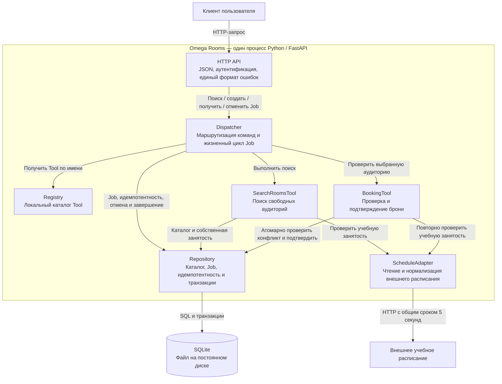

# Архитектура Omega Rooms

Практика 2, пункт 1. Автор: СунцовВС (`Waltans`). Это целевая архитектура
первой реализации на Python и FastAPI; исполняемого приложения в репозитории пока нет.
Основание — [сценарии и границы Job](requirements.md).

## Контекст системы (C4 Context)

**Стрелки показывают вызовы во время работы:** инициатор обращается к получателю;
ответ возвращается по тому же соединению, отдельной стрелкой не показан.
Это не зависимости исходного кода. Клиент пользователя находится вне границы сервиса.
Внешнее расписание читается, но не изменяется. Каталог аудиторий и собственные брони
хранятся внутри Omega Rooms. LLM и управление физическим доступом в первую версию не входят.

## Компоненты

**Стрелки показывают вызовы во время работы:** от вызывающего компонента к
вызываемому; ответы не показаны. Registry возвращает ссылку на заранее
зарегистрированный локальный Tool, после чего Dispatcher вызывает его напрямую.
Tool не обращается к HTTP API или Dispatcher. Диаграмма не задаёт зависимости импортов.

| Компонент | Ответственность и что скрывает от соседей |
| --- | --- |
| HTTP API | Проверяет JSON, типы полей и учётные данные; переводит команды и результаты в HTTP, скрывая FastAPI, заголовки и сериализацию от Dispatcher. |
| Dispatcher | Выбирает Tool через Registry, проверяет владельца Job и координирует разрешённые переходы, скрывая порядок шагов сценария от HTTP API. |
| Registry | Сопоставляет имя операции с локальным Tool, скрывая конкретный класс и создание его зависимостей от Dispatcher. |
| SearchRoomsTool | Фильтрует аудитории по вместимости, оборудованию и занятости всего интервала, скрывая алгоритм поиска от Dispatcher. Поиск не создаёт Job и не резервирует аудиторию. |
| BookingTool | Проверяет правила времени и занятость, подтверждает бронь через атомарную операцию Repository, скрывая порядок проверок и обнаружение конфликта от Dispatcher. Возвращает исход проверки; техническая ошибка становится `failed`. |
| ScheduleAdapter | Возвращает нормализованные интервалы занятости или типизированную ошибку, скрывая URL, протокол, формат внешнего ответа, повторы и тайм-аут от Tool. |
| Repository | Читает каталог, сохраняет Job и ключи идемпотентности, атомарно проверяет конфликт и меняет состояния, скрывая SQL, схему таблиц, блокировки и SQLite от вызывающих компонентов. |
| SQLite | Надёжно сохраняет данные на постоянном диске и обеспечивает транзакции; детали файлового хранения скрыты за Repository. Каталог заполняется при развёртывании, публичного API редактирования нет. |

## Как проходит запрос

1. HTTP API определяет пользователя по заранее выданному Bearer-токену
   и проверяет структуру запроса. Выдача токенов не входит в публичный API.
   Другому пользователю Job не виден: получение и отмена отвечают `404`.
2. Поиск исполняется синхронно через SearchRoomsTool. Если совпадений нет,
   возвращается пустой список; при недоступном расписании — ошибка, а не список
   якобы свободных аудиторий. Интервалы полуоткрытые: `[start_at, end_at)`.
3. При создании брони Dispatcher атомарно сохраняет `created` вместе с ключом
   идемпотентности и переводит Job в `checking`. BookingTool сначала проверяет
   время относительно одного снимка часов в UTC, затем аудиторию и расписание.
   Отсутствие смещения, конец не позже начала и начало в прошлом дают `rejected`
   до обращения к расписанию. Неправильная структура JSON даёт `422` без Job.
4. На все обращения к расписанию в рамках одной проверки отводится общий срок
   5 секунд, включая повторы. Некорректный ответ или истечение срока дают `failed`;
   поздний ответ не может подтвердить такой Job.
5. После проверки расписания Repository открывает транзакцию записи SQLite
   (`BEGIN IMMEDIATE`), повторно проверяет пересечения с собственными
   подтверждёнными бронями и ожидаемое состояние `checking`. При свободном интервале
   в этой же транзакции сохраняется `confirmed`, иначе — `rejected`.
   Сетевой запрос не держит транзакцию записи. При двух конкурирующих заявках
   подтверждается только первая атомарно зафиксированная бронь; поиска заранее
   недостаточно. Изменение внешнего расписания после его чтения не блокируется
   сервисом: общей транзакции с университетской системой нет.
6. `POST /jobs` ждёт исхода проверки и возвращает созданный Job (`201`), в том
   числе с `rejected` или `failed` и причиной в едином формате ошибок.
   Повтор с тем же `Idempotency-Key` и тем же телом возвращает `200` с тем же Job
   в текущем состоянии, включая `created` или `checking`, без нового выполнения.
   Изменённое тело с тем же ключом даёт `409`. Ключи изолированы по пользователям,
   сохраняются вместе с Job и не истекают в первой версии.
7. Отмена допускается только из `confirmed` и строго до `start_at`; проверка
   времени, состояния и освобождение интервала выполняются одной транзакцией.
   Завершение в `completed` при `now >= end_at` выполняется лениво: Repository
   обновляет просроченные подтверждённые Job перед чтением или изменением их состояния.
   Отдельный планировщик и очередь не требуются. Проверка занятости всегда учитывает
   сам интервал, поэтому просроченная бронь не блокирует будущие встречи.

После перезапуска уже сохранённые `created` и `checking` переводятся в `failed`
с причиной `PROCESSING_INTERRUPTED` до начала обслуживания новых запросов.
Повтор с прежним ключом получает этот же Job; повторить попытку бронирования
можно новым запросом с новым ключом. Подтверждение и запись `confirmed` атомарны,
поэтому восстановление не превращает уже созданную бронь в `failed`.

Подробные состояния и ответы на запрещённые переходы приведены
в [жизненном цикле Job](job-lifecycle.md).
