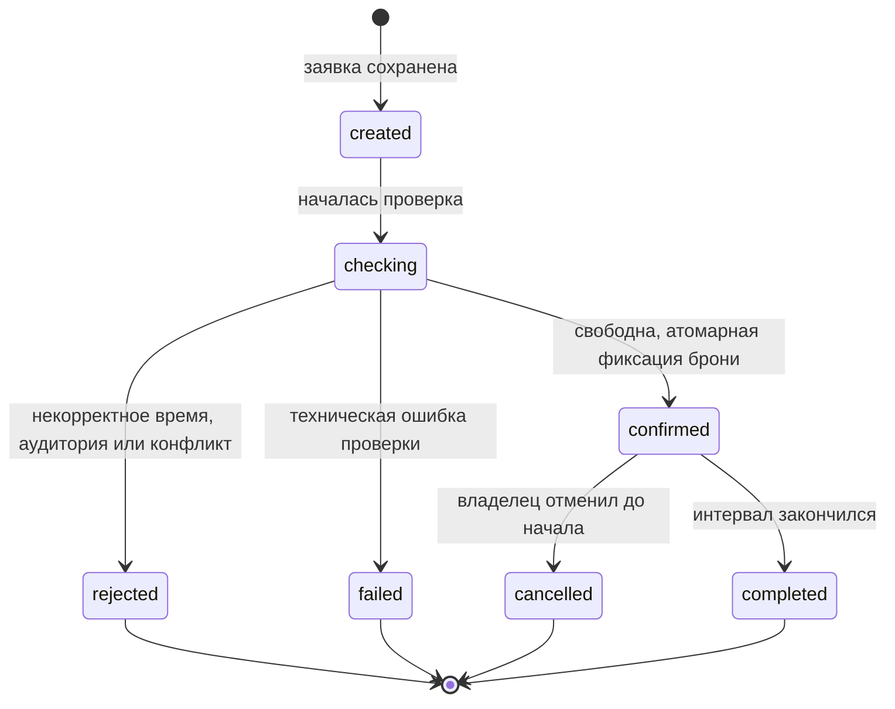

# Жизненный цикл Job

Практика 2, пункт 2. Автор: СунцовВС (`Waltans`). Основание — раздел
«Жизненный цикл Job» и сценарии 2–6 в [требованиях](requirements.md).
Job — одна заявка одного пользователя на одну аудиторию и интервал.
Поиск не создаёт Job. Идентификатор Job одновременно идентифицирует бронь
после её подтверждения; отдельный публичный идентификатор брони не нужен.

## Все состояния и разрешённые переходы



Стрелки здесь обозначают **переходы состояний**, а не вызовы компонентов
или зависимости кода. `[*]` — начало или конец жизненного цикла,
а не дополнительное состояние Job.

| Состояние | Значение и наличие брони |
| --- | --- |
| `created` | Заявка и ключ идемпотентности сохранены, проверка ещё не началась; брони нет. |
| `checking` | Проверяются правила времени и доступность; брони ещё нет. |
| `confirmed` | Бронь атомарно создана и занимает свой интервал, пока не отменена или не завершилась. |
| `rejected` | Нарушены бизнес-правила: некорректное время, неизвестная аудитория или конфликт; брони нет. Конечное состояние. |
| `failed` | Проверку не удалось завершить технически; брони нет. Конечное состояние. |
| `cancelled` | Бронь отменена до начала, собственная занятость освобождена. Конечное состояние. |
| `completed` | Забронированный интервал закончился, история сохраняется. Конечное состояние. |

| Переход | Кто инициирует и какое условие проверяется |
| --- | --- |
| `created → checking` | Dispatcher начинает выполнение принятой заявки. При восстановлении незавершённого `created` сначала выполняется этот переход, затем `checking → failed` с `PROCESSING_INTERRUPTED`, без вызова Tool. |
| `checking → confirmed` | BookingTool получил корректный ответ расписания; Repository в одной транзакции проверил отсутствие собственных пересечений, состояние `checking` и создал бронь. |
| `checking → rejected` | До внешнего вызова обнаружено некорректное время или неизвестная аудитория, либо проверка выявила занятость. В Job записывается причина с именем ошибочного поля. |
| `checking → failed` | Общий срок внешней проверки 5 секунд исчерпан (`SCHEDULE_TIMEOUT`), ответ некорректен (`SCHEDULE_INVALID_RESPONSE`), источник недоступен (`SCHEDULE_UNAVAILABLE`) или обработка прервана перезапуском (`PROCESSING_INTERRUPTED`). |
| `confirmed → cancelled` | Только владелец, только при `now < start_at`; проверка и изменение атомарны. При равенстве времени начала отменять уже нельзя. |
| `confirmed → completed` | Сервис при `now >= end_at`; обновление перед чтением или изменением состояния. Клиент не может командой завершить Job. |

Время сравнивается в UTC. Проверка интервала в `checking` берёт текущее время
однократно; `start_at >= now`, `end_at > start_at`, обе границы содержат дату,
время и смещение (`Z` или `±HH:MM`). Нарушение этих правил даёт `rejected`
**до** обращения к расписанию. Отменённая бронь снова доступна для поиска
только при отсутствии других броней и занятий на всём интервале.

## Запрещённые переходы и ответы системы

**Любой переход между семью состояниями, кроме шести перечисленных, запрещён.**
В том числе запрещены переход в то же состояние, выход из конечного состояния,
`created → confirmed`, `checking → cancelled` и повторное подтверждение.
Повтор HTTP-запроса или чтение Job не являются переходом.

Публичный API позволяет создать заявку, получить состояние и отменить бронь.
Операций «установить state», «подтвердить вручную», «перезапустить Job» нет;
поле `state` в теле создания отвергается как лишнее с `422 VALIDATION_ERROR`.
Для новой попытки после `rejected` или `failed` нужен новый Job и новый ключ
идемпотентности, старый Job не меняется.

| Попытка | Ответ и побочный эффект |
| --- | --- |
| Отменить `created`, `checking`, `rejected`, `failed`, `cancelled` или `completed` | `409 INVALID_JOB_TRANSITION`, `details[].field = state`; Job и занятость не меняются. Повторная отмена также даёт `409`. |
| Отменить `confirmed` при `now >= start_at` | `409 CANCELLATION_TOO_LATE`, `details[].field = start_at`; бронь сохраняется. Если интервал уже закончился, перед командой Job становится `completed` и ответ — `409 INVALID_JOB_TRANSITION`. |
| Получить или отменить неизвестный либо чужой Job | `404 JOB_NOT_FOUND`, `details[].field = job_id`; существование чужого Job не раскрывается. |
| Повторить создание с прежним ключом и тем же телом | `200`, прежний `id` и текущее состояние; новая проверка и новая бронь не создаются. Это чтение результата, а не переход. |
| Повторить создание с прежним ключом и изменённым телом | `409 IDEMPOTENCY_KEY_REUSED`, `details[].field = Idempotency-Key`; исходный Job не меняется. |
| Передать `state` в теле создания | `422 VALIDATION_ERROR`, `details[].field = state`; новый Job не создаётся. |
| Внутренний обработчик пытается выполнить иной переход или подтвердить Job после `failed` | Repository отклоняет условное обновление; HTTP-ответа внешнему расписанию нет. Состояние и бронь не меняются, событие записывается в журнал. |

Технический отказ в доступе к хранилищу не изображается успешным переходом:
HTTP API возвращает `503 STORAGE_UNAVAILABLE` в том же формате ошибок.
При потере ответа клиент читает Job или повторяет создание с тем же ключом.

Ошибки HTTP и причины в `Job.error` имеют одну структуру:

```json
{
  "code": "INVALID_JOB_TRANSITION",
  "message": "Отмена разрешена только для подтверждённой брони",
  "details": [
    {
      "field": "state",
      "issue": "Job находится в cancelled; требуется confirmed"
    }
  ]
}
```

`field` — имя поля тела, параметра пути или заголовка; вложенные поля записываются
через точку. Для ошибки без отдельного поля используется `$` (запрос целиком).
У `rejected` и `failed` поле `error` обязательно и содержит причину; у остальных
состояний его нет. `POST /jobs` возвращает `201` и Job даже при бизнес-отказе или
техническом исходе проверки: HTTP-создание заявки состоялось, состояние брони
нужно читать в `state`. Ошибки до создания заявки возвращаются отдельным Error.

Все изменения состояний выполняются с проверкой ожидаемого предыдущего состояния
в транзакции Repository. Поздний внешний ответ после `failed` и конкурирующая
команда не могут обойти эту проверку. Реализация компонентов описана
в [архитектуре](architecture.md).
